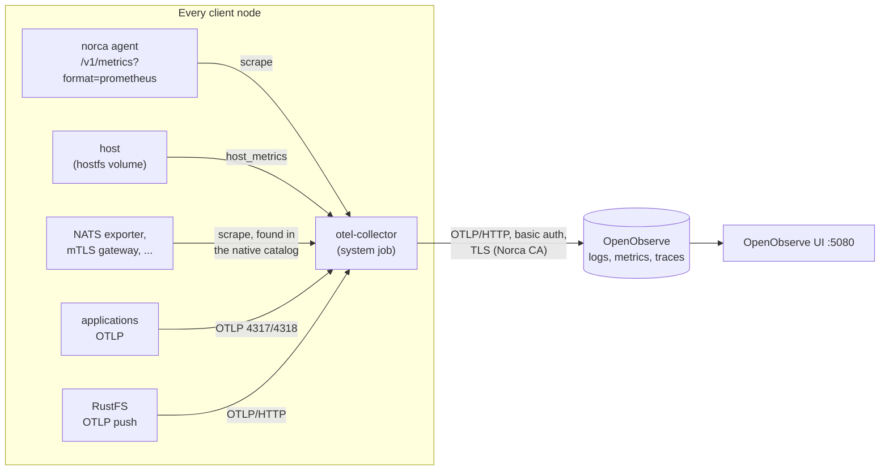

Norca agents report the runtime metrics of Nomad v1.6.5 and the metrics of
the Norca features through the agent's [`telemetry` block](/docs/configuration/telemetry).
This page shows how to expose them to Prometheus, which Norca metrics to
watch, and how to run a complete metrics, traces and logs pipeline with the
`otel-collector` and `openobserve` packs of the
[Norca pack registry](/docs/features/packages/registry). The metrics
themselves are described in [Monitoring Norca agents](/docs/operations/monitoring-nomad)
and the [Metrics reference](/docs/operations/metrics-reference).

## Agent telemetry

Turn on the Prometheus format on every agent, servers and clients:

```hcl {filename="norca.hcl"}
telemetry {
  prometheus_metrics         = true
  publish_allocation_metrics = true
  publish_node_metrics       = true
}
```

Every agent then serves its metrics at `/v1/metrics?format=prometheus`; without
`prometheus_metrics` the endpoint answers the Prometheus format with an error,
and `/v1/metrics` returns JSON. The endpoint has no ACL check. With TLS on the
HTTP API, scrape it over HTTPS with the CA of the agent certificates.

```shell
curl --cacert nomad-agent-ca.pem "https://127.0.0.1:4646/v1/metrics?format=prometheus"
```

Metric names keep the Nomad prefix, as part of the compatibility surface:
`nomad.backup.size_bytes` is `nomad_backup_size_bytes` in Prometheus.
Dashboards and alerts written for Nomad v1.6.5 keep working.

Other sinks of the `telemetry` block (statsd, statsite, Datadog, Circonus) work
as in Nomad v1.6.5.

## Norca metrics

Besides the metrics of Nomad v1.6.5, the servers report metrics of the Norca
features under the same prefix. The most useful for alerting:

| Feature | Metrics | Watch for |
| --- | --- | --- |
| Backups | `nomad.backup.last_success_age_seconds`, `nomad.backup.size_bytes`, `nomad.backup.duration_seconds`, `nomad.backup.failures_total` (label `destination`) | see [Backups](#backups) |
| Built-in autoscaler | `nomad.autoscaler.*` (evaluations, scaling actions, errors, rate limiting, oscillation suspensions) | see [Autoscaler telemetry](/docs/features/autoscaler/reference/telemetry) |
| Admission control | `nomad.admission.denied`, `nomad.admission.webhook.calls`, `.errors`, `.latency` | failing or slow webhooks |
| Native mTLS | `nomad.mtls.certificates_issued`, `nomad.mtls.sign_certificate`, `nomad.mtls.rotate_ca` | certificate issuing errors |
| Service catalog | `nomad.service_registration.health_updates`, `.health_updates_deferred`, external service metrics | deferred health updates |
| Disruption budget | `nomad.alloc.evict`, `nomad.job.disruption` | refused evictions during drains |
| Seal and secrets | `nomad.seal.unseal`, `nomad.seal.recover`, `nomad.keyring.rewrap`, `nomad.secret.*` | |
| Network rules | `nomad.client.allocs.network_policy.dropped` (clients) | dropped connections |

The RPC endpoints of the Norca features (quotas, releases, custom objects,
network policies, intentions, backups) also report timing metrics such as
`nomad.quota.upsert_quota_specs` or `nomad.backup.restore`, like the RPC
metrics of Nomad.

### Backups

The leader of each region reports the state of its backups:

| Metric | Type | Description |
| --- | --- | --- |
| `nomad.backup.last_success_age_seconds` | gauge | Age of the last successful backup |
| `nomad.backup.size_bytes` | gauge, per `destination` | Size of the state object of the last backup |
| `nomad.backup.duration_seconds` | gauge, per `destination` | Duration of the last upload |
| `nomad.backup.failures_total` | counter, per `destination` (`all` when the backup failed before the upload) | Failed backups |

Suggested alerts:

- the last successful backup is older than twice the interval
  (`nomad_backup_last_success_age_seconds > 7200` for an hourly schedule);
- `nomad_backup_failures_total` increases for a destination; after three
  failures in a row the leader also logs an error.

`norca operator backup list` shows the same as a warning when the last
successful backup is older than two intervals. The metrics come from the
current leader only, so scrape all servers. See
[Backup and restore operations](/docs/operations/backup-restore).

### System bus

[`norca operator bus status`](/docs/commands/operator/bus/status) (or
`GET /v1/operator/bus` on each server) shows the routes, the JetStream meta
leader, the streams with their message counts and the connections of the
[system bus](/docs/features/system-bus) of a server. Check that every server
of a region is clustered with routes to the others, that JetStream has a meta
leader, and that `NORCA_EVENTS_<region>` grows; gap markers on
`<prefix>.<region>.Bus` mean that events were lost because the event buffer
of the servers overflowed.

## A metrics, traces and logs stack from the registry

The Norca pack registry has two packs for a self-hosted observability stack:

- **otel-collector**: the OpenTelemetry Collector (Apache-2.0) as a system
  job, one collector per node. It scrapes the host, the local Norca agent and
  the instances of other registry packs on the same node (NATS, Forgejo, the
  mTLS gateway, Consul, PostgreSQL), found through the native service catalog,
  and receives OTLP traces, metrics and logs from the applications of the node.
- **openobserve**: [OpenObserve](https://openobserve.ai) as the backend for
  logs, metrics and traces, in single mode (one instance, SQLite, a host
  volume) or cluster mode (PostgreSQL, NATS and an S3 store). OpenObserve is
  AGPL-3.0 software; the pack only references its official image, Norca does
  not ship it.



The collector authenticates to OpenObserve with ingest credentials that the
openobserve pack's bootstrap task writes into the built-in secret store, and
by default verifies OpenObserve's workload certificate against the trust
bundle of the region (native mTLS app mode).

### Deploy the stack

The steps of the [single node example](/docs/getting-started/examples/02-single-node)
(without native mTLS, so both run without TLS):

{}

### Prepare the nodes

On the OpenObserve node a host volume for its data, and on every client the
host's root directory, read-only, for the host metrics:

```hcl
client {
  host_volume "openobserve" {
    path      = "/srv/openobserve"
    read_only = false
  }

  host_volume "hostfs" {
    path      = "/"
    read_only = true
  }
}
```

```shell
sudo install -d -m 700 /srv/openobserve
```

### Deploy OpenObserve

```shell
norca namespace apply -description "Observability" observability
norca secret put -namespace observability openobserve/root password=-   # 8+ chars: upper, lower, digit, special
norca pack run openobserve --registry=norca --namespace=observability \
  --var namespace=observability --var tls_mode=none
norca alloc logs -namespace observability -task bootstrap <alloc ID>     # "ingest credentials ... stored"
```

### Deploy the collectors

With TLS on the agents' HTTP API, give the collector the CA of the agent
certificates:

```shell
norca secret put -namespace observability norca/agent-ca ca=@/etc/norca.d/tls/nomad-agent-ca.pem
norca pack run otel-collector --registry=norca --namespace=observability \
  --var namespace=observability --var openobserve_tls=none \
  --var nomad_address=https://127.0.0.1:4646 --var nomad_ca_secret_path=norca/agent-ca \
  --var 'discovery_namespaces=["default","apps"]'
```

`discovery_namespaces` lists the namespaces whose services the collectors
look for.

### Turn on the metrics of other packs

Packs that have no Prometheus endpoint of their own get an exporter or push
OTLP when their `metrics_enabled` variable is set:

```shell
norca pack upgrade nats --registry=norca --name=nats -f nats.hcl --var metrics_enabled=true
norca pack upgrade rustfs --registry=norca --name=rustfs -f rustfs.hcl --var metrics_enabled=true
```

### Open the UI

Open `http://<node>:5080/` and log in as `root@openobserve.internal` with the
password of `openobserve/root`. The host and agent metrics arrive in the
organization `default` within a minute.

{}

With native mTLS (the [three-node example](/docs/getting-started/examples/03-three-node)),
leave out `tls_mode=none` and `openobserve_tls=none`: OpenObserve then serves
HTTPS with its workload certificate, and the collectors verify it.

### Applications

Applications send OTLP to the collector of their own node:

```hcl
env {
  OTEL_EXPORTER_OTLP_ENDPOINT = "http://${attr.unique.network.ip-address}:4318"
  OTEL_EXPORTER_OTLP_PROTOCOL = "http/protobuf"
  OTEL_SERVICE_NAME           = "${NOMAD_JOB_NAME}"
}
```

The OTLP receiver has no authentication and no TLS: keep its ports on the
private network (`host_network` of the pack). Task logs written to stdout and
stderr are not collected by the pack; send logs over OTLP, or read them with
`norca alloc logs`.

### Several regions

Secrets, catalogs and workload certificates are regional. Deploy the stack in
every region (`-region` with the CLI, `--region` with the packs), so the
collectors of a region export to the OpenObserve of that region; see the
[multi-region example](/docs/getting-started/examples/04-multi-region).

## Prometheus without the packs

An existing Prometheus can scrape the agents directly at
`/v1/metrics?format=prometheus`, and find the services of the cluster with its
`nomad_sd_configs` against any agent, or with `consul_sd_configs` against the
[Consul-compatible API](/docs/features/service-discovery/consul-compatible-api)
of Norca.

## See also

- [`telemetry` block](/docs/configuration/telemetry)
- [Monitoring Norca agents](/docs/operations/monitoring-nomad) and the
  [Metrics reference](/docs/operations/metrics-reference)
- [Metrics HTTP API](/docs/api/metrics)
- The [otel-collector](https://github.com/bacanoo-io/norca-registry/blob/main/packs/otel-collector/README.md)
  and [openobserve](https://github.com/bacanoo-io/norca-registry/blob/main/packs/openobserve/README.md)
  pack READMEs
