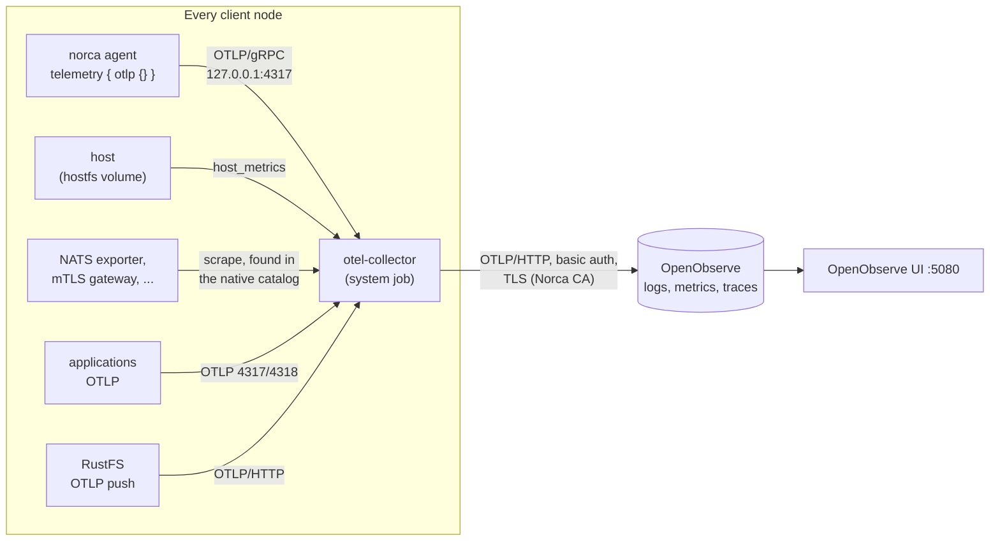

Norca agents report the runtime metrics of Nomad v1.6.5 and the metrics of
the Norca features through the agent's [`telemetry` block](/docs/configuration/telemetry).
This page shows how to send them over OTLP or expose them to Prometheus,
which Norca metrics to watch, and how to run a complete metrics, traces and
logs pipeline with the
`otel-collector` and `openobserve` modules of the
[Norca registry](/docs/features/packages/registry). The metrics
themselves are described in [Monitoring Norca agents](/docs/operations/monitoring-nomad)
and the [Metrics reference](/docs/operations/metrics-reference).

## Agent telemetry

Every agent keeps the metrics of the last minute in memory and serves them as
JSON at [`/v1/metrics`](/docs/api/metrics), whatever else is configured.
**Norca needs no external metrics system:** the
[metrics store](/docs/configuration/metrics_store), the charts of the web UI
and the built-in autoscaler use their own sources. Two outputs send the
metrics to a monitoring system; they can run side by side.

### OTLP to the collector of the node (recommended)

The agent pushes its metrics over OTLP/gRPC to the OpenTelemetry Collector of
its own node, which forwards them to the backend: the `otel-collector` module
in its OTLP mode ([below](#a-metrics-traces-and-logs-stack-from-the-registry))
or any collector listening on `127.0.0.1:4317`. Every agent, servers and
clients:

```hcl {filename="norca.hcl"}
telemetry {
  publish_allocation_metrics = true
  publish_node_metrics       = true

  otlp {}   # 127.0.0.1:4317, plain text on the loopback interface
}
```

- **Nothing leaves the node in plain text:** the agent sends without TLS only
  to a loopback address; any other endpoint uses TLS.
- **A node without a collector**, such as a server that runs no client, sends
  to a central receiver instead: `endpoint` with a `tls` block and the
  credentials in a `headers_file` or a client certificate (see the
  [examples](/docs/configuration/telemetry#otlp-examples)).
- **Failed exports** are logged at most once a minute and counted in
  `norca.agent.otlp.export_errors`.
- Other backends are reached through the collector and its exporters.

### Prometheus

The agent serves the Prometheus format for a Prometheus server that scrapes
it:

```hcl {filename="norca.hcl"}
telemetry {
  publish_allocation_metrics = true
  publish_node_metrics       = true

  prometheus {
    enabled = true
  }
}
```

Every agent then serves its metrics at `/v1/metrics?format=prometheus`; without
the `prometheus` block the endpoint answers the Prometheus format with an
error, and `/v1/metrics` returns JSON. **The endpoint has no ACL check.** With
TLS on the HTTP API, scrape it over HTTPS with the CA of the agent
certificates.

```shell
curl --cacert norca-agent-ca.pem "https://127.0.0.1:4646/v1/metrics?format=prometheus"
```

### Metric names

Every metric name starts with `norca.` and its family: `norca.server.*` (the
servers), `norca.client.*` (the clients), `norca.raft.*`, `norca.runtime.*`
and the others of the [Metrics reference](/docs/operations/metrics-reference#metric-names).
OTLP keeps the dots; Prometheus uses underscores:
`norca.server.backup.size_bytes` is `norca_server_backup_size_bytes`.

### Traces and logs

- **Traces:** the same `otlp` block exports the agent's traces: the HTTP API
  requests, the RPCs and Raft writes of the servers, the scheduling of the
  evaluations and the phases of the allocations on the clients. The
  collector of the node forwards them with the metrics. See
  [Tracing](/docs/operations/tracing).
- **Logs:** the agent's logs are structured, with one key convention across
  the agent, and carry the `trace_id` of a traced request. With
  `logs { enabled = true }` the same `otlp` block exports them as log records,
  joined to their traces. See [Logging](/docs/operations/logging).
- **Events:** the leader can export the event stream of the region (jobs,
  allocations, deployments, nodes, ...) as log records too, so the backend
  keeps the history of the cluster's changes. See
  [Event export](/docs/operations/event-export).
- **Audit:** every server logs an audit record of each operator write call
  it handles: who called, what, and the result. See
  [Audit records](/docs/operations/audit-log).

## Norca metrics

Besides the metrics of Nomad v1.6.5, the servers report metrics of the Norca
features under the same prefix. The most useful for alerting:

| Feature | Metrics | Watch for |
| --- | --- | --- |
| Backups | `norca.server.backup.last_success_age_seconds`, `norca.server.backup.size_bytes`, `norca.server.backup.duration_seconds`, `norca.server.backup.failures_total` (label `destination`) | see [Backups](#backups) |
| Built-in autoscaler | `norca.autoscaler.*` (evaluations, scaling actions, errors, rate limiting, oscillation suspensions) | see [Autoscaler telemetry](/docs/features/autoscaler/reference/telemetry) |
| Admission control | `norca.server.admission.denied`, `norca.server.admission.webhook.calls`, `.errors`, `.latency` | failing or slow webhooks |
| Native mTLS | `norca.server.mtls.certificates_issued`, `norca.server.mtls.sign_certificate`, `norca.server.mtls.rotate_ca` | certificate issuing errors |
| Service catalog | `norca.server.service_registration.health_updates`, `.health_updates_deferred`, external service metrics | deferred health updates |
| Disruption budget | `norca.server.alloc.evict`, `norca.server.job.disruption` | refused evictions during drains |
| Seal and secrets | `norca.server.seal.unseal`, `norca.server.seal.recover`, `norca.server.keyring.rewrap`, `norca.server.secret.*`, the leader's gauges `norca.server.secrets.expiring`, `norca.server.secrets.expired`, `norca.server.secrets.rotation_due` and the counters `norca.server.secrets.rotation.dispatched`, `norca.server.secrets.rotation.failed` | expired secrets, rotations that stay due, failed rotation dispatches |
| Network rules | `norca.client.allocs.network_policy.dropped` (clients) | dropped connections |

The RPC endpoints of the Norca features (quotas, releases, custom objects,
network policies, intentions, backups) also report timing metrics such as
`norca.server.quota.upsert_quota_specs` or `norca.server.backup.restore`, like the RPC
metrics of Nomad.

### Backups

The leader of each region reports the state of its backups:

| Metric | Type | Description |
| --- | --- | --- |
| `norca.server.backup.last_success_age_seconds` | gauge | Age of the last successful backup |
| `norca.server.backup.size_bytes` | gauge, per `destination` | Size of the state object of the last backup |
| `norca.server.backup.duration_seconds` | gauge, per `destination` | Duration of the last upload |
| `norca.server.backup.failures_total` | counter, per `destination` (`all` when the backup failed before the upload) | Failed backups |

Suggested alerts:

- the last successful backup is older than twice the interval
  (`norca_server_backup_last_success_age_seconds > 7200` for an hourly schedule);
- `norca_server_backup_failures_total` increases for a destination; after three
  failures in a row the leader also logs an error.

`norca operator backup list` shows the same as a warning when the last
successful backup is older than two intervals. **The metrics come from the
current leader only, so collect them from all servers.** See
[Backup and restore operations](/docs/operations/backup-restore).

### System bus

[`norca operator bus status`](/docs/commands/operator/bus/status) (or
`GET /v1/operator/bus` on each server) shows the routes, the JetStream meta
leader, the streams with their message counts and the connections of the
[system bus](/docs/features/system-bus) of a server. Check that every server
of a region is clustered with routes to the others, that JetStream has a meta
leader, and that `NORCA_EVENTS_<region>` grows; gap markers on
`<prefix>.<region>.Bus` mean that events were lost because the event buffer
of the servers overflowed.

## A metrics, traces and logs stack from the registry

The Norca registry has two modules for a self-hosted observability stack:

- **otel-collector**: the OpenTelemetry Collector (Apache-2.0) as a system
  job, one collector per node. It receives the OTLP of the local Norca agent
  on `127.0.0.1:4317` (its OTLP mode, `nomad_otlp_enabled`; otherwise it
  scrapes the agent's Prometheus output), scrapes the host and the instances
  of other registry modules on the same node (NATS, Forgejo, the mTLS
  gateway, Consul, PostgreSQL), found through the native service catalog, and
  receives OTLP traces, metrics and logs from the applications of the node.
- **openobserve**: [OpenObserve](https://openobserve.ai) as the backend for
  logs, metrics and traces, in single mode (one instance, SQLite, a host
  volume) or cluster mode (PostgreSQL, NATS and an S3 store). OpenObserve is
  AGPL-3.0 software; the module only references its official image, Norca does
  not ship it.



The collector authenticates to OpenObserve with ingest credentials that the
openobserve module's bootstrap task writes into the built-in secret store, and
by default verifies OpenObserve's workload certificate against the trust
bundle of the region (native mTLS app mode).

### Deploy the stack

The steps of the [single node example](/docs/getting-started/examples/02-single-node)
(without native mTLS, so both run without TLS):

{}

### Prepare the nodes

Every agent pushes its telemetry to the collector of its node (servers
without a client: see [Agent telemetry](#otlp-to-the-collector-of-the-node-recommended)):

```hcl
telemetry {
  publish_allocation_metrics = true
  publish_node_metrics       = true

  otlp {}
}
```

On the OpenObserve node a host volume for its data, and on every client the
host's root directory, read-only, for the host metrics:

```hcl
client {
  host_volume "openobserve" {
    path      = "/srv/openobserve"
    read_only = false
  }

  host_volume "hostfs" {
    path      = "/"
    read_only = true
  }
}
```

```shell
sudo install -d -m 700 /srv/openobserve
```

### Deploy OpenObserve

The servers install both modules from the global registry, into the namespace
of the request:

```shell
norca namespace apply -description "Observability" observability
norca secret put -namespace observability openobserve/root password=-   # 8+ chars: upper, lower, digit, special
norca rigger registry sync global
norca operator api -namespace observability -X PUT /v1/rigger/install <<'EOF'
{"Release": "openobserve", "Registry": "global", "Module": "norca/openobserve", "Version": "~> 0.2",
 "ValuesJSON": {"tls_mode": "none"}}
EOF
norca alloc logs -namespace observability -task bootstrap <alloc ID>     # "ingest credentials ... stored"
```

### Deploy the collectors

With TLS on the agents' HTTP API, give the collector the CA of the agent
certificates:

```shell
norca secret put -namespace observability norca/agent-ca ca=@/etc/norca.d/tls/norca-agent-ca.pem
norca operator api -namespace observability -X PUT /v1/rigger/install <<'EOF'
{"Release": "otel-collector", "Registry": "global", "Module": "norca/otel-collector", "Version": "~> 0.2",
 "ValuesJSON": {"openobserve_tls": "none", "nomad_otlp_enabled": true, "nomad_address": "https://127.0.0.1:4646",
                "nomad_ca_secret_path": "norca/agent-ca", "discovery_namespaces": ["default", "apps"]}}
EOF
```

`nomad_otlp_enabled` adds the agents' receiver on `127.0.0.1:4317` and turns
the scrape of the agents off; `nomad_address` is still used to find the
services of `discovery_namespaces`, the namespaces whose services the
collectors look for. Without `nomad_otlp_enabled` the collectors scrape the
agents' Prometheus output instead, which needs the `prometheus` block on every
agent.

### Turn on the metrics of other modules

Modules that have no Prometheus endpoint of their own get an exporter or push
OTLP when their `metrics_enabled` variable is set. Installing a release again
with the value added upgrades it. For releases installed from a checkout of
the registry:

```shell
norca rigger install <checkout>/modules/nats -name nats -f nats.hcl -var metrics_enabled=true
norca rigger install <checkout>/modules/rustfs -name rustfs -f rustfs.hcl -var metrics_enabled=true
```

For a release the servers installed from the global registry, send its
request again with `"metrics_enabled": true` among the values of `ValuesJSON`.

### Open the UI

Open `http://<node>:5080/` and log in as `root@openobserve.internal` with the
password of `openobserve/root`. The host and agent metrics arrive in the
organization `default` within a minute.

{}

With native mTLS (the [three-node example](/docs/getting-started/examples/03-three-node)),
leave out `tls_mode` and `openobserve_tls`: OpenObserve then serves
HTTPS with its workload certificate, and the collectors verify it.

### Applications

Applications send OTLP to the collector of their own node:

```hcl
env {
  OTEL_EXPORTER_OTLP_ENDPOINT = "http://${attr.unique.network.ip-address}:4318"
  OTEL_EXPORTER_OTLP_PROTOCOL = "http/protobuf"
  OTEL_SERVICE_NAME           = "${NORCA_JOB_NAME}"
}
```

**The OTLP receiver has no authentication and no TLS: keep its ports on the
private network** (`host_network` of the module). Task logs written to stdout and
stderr are not collected by the module; send logs over OTLP, or read them with
`norca alloc logs`.

### Several regions

Secrets, catalogs and workload certificates are regional. Deploy the stack in
every region (`-region` with every command), so the
collectors of a region export to the OpenObserve of that region; see the
[multi-region example](/docs/getting-started/examples/04-multi-region).

## Prometheus without the modules

An existing Prometheus can scrape the agents directly at
`/v1/metrics?format=prometheus` (`telemetry { prometheus { enabled = true } }`
on every agent, see [Prometheus](#prometheus)), and find the services of the
cluster with its
`nomad_sd_configs` against any agent, or with `consul_sd_configs` against the
[Consul-compatible API](/docs/features/service-discovery/consul-compatible-api)
of Norca.

## See also

- [`telemetry` block](/docs/configuration/telemetry)
- [Tracing](/docs/operations/tracing), [Logging](/docs/operations/logging) and
  [Audit records](/docs/operations/audit-log)
- [Monitoring Norca agents](/docs/operations/monitoring-nomad) and the
  [Metrics reference](/docs/operations/metrics-reference)
- [Metrics HTTP API](/docs/api/metrics)
- The [otel-collector](https://github.com/bacanoo-io/norca-registry/blob/main/modules/otel-collector/README.md)
  and [openobserve](https://github.com/bacanoo-io/norca-registry/blob/main/modules/openobserve/README.md)
  module READMEs
