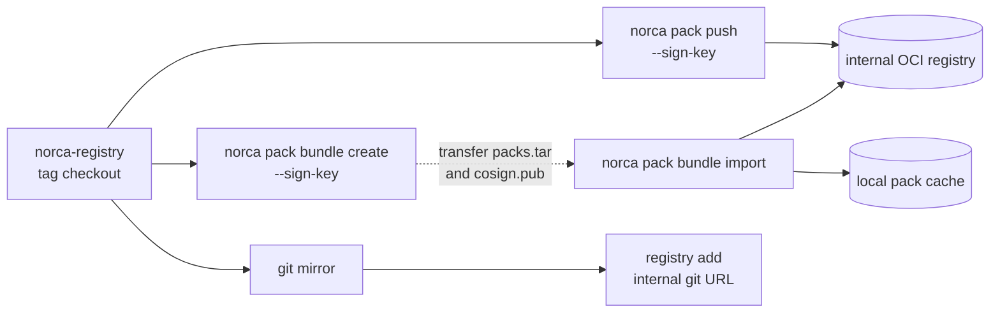

This page describes how to run the packs of the [Norca pack registry](/docs/features/packages/registry)
in day-to-day operation: pinning a release tag, moving to a new tag, and installing in clusters
without internet access. The pack commands themselves are described in
[Using norca pack](/docs/features/packages/pack).

## Pinning a registry release

The registry is released as a whole with tags `vMAJOR.MINOR.PATCH` that are never moved; `main` may
change at any time. Pin a tag when adding the registry; the pack commands then use it:

```shell
norca pack registry add norca https://github.com/bacanoo-io/norca-registry --ref=v0.1.0
norca pack registry list

norca pack plan nats --registry=norca -f nats.hcl
norca pack run  nats --registry=norca -f nats.hcl
```

- The cache keeps every ref of a registry in its own directory, and the ref the registry was last
  added or updated with is its default ref: a pack command without `--ref` uses the pack at that ref
  (here `v0.1.0`). See [refs and deployment names](/docs/commands/pack#refs-and-deployment-names).
- Without `--name` the release is named after the pack (`nats`), so an upgrade to another tag adds a
  revision to the same release. With an explicit `--ref` the default name contains the ref
  (`nats@v0.1.0` becomes the release `nats-v0.1.0`): give `--name` then, or a later upgrade to
  another tag creates a second release.
- Releases that earlier versions installed without `--name` and `--ref` are named `nats-latest`
  (deployment `nats@latest`); manage them with `--ref=latest` or `--name=nats@latest`.
- Keep the variable files of your installations (`-f nats.hcl`) in version control next to the
  registry tag they were written for. The registry's `examples/<pack>/` directory has starting points.
- The release records the pack name and version of every revision: `norca pack history nats` shows
  which pack version each revision used, and `norca pack status nats --registry=norca` the deployed one.

## Updating to a new registry release

Read the release notes of the new tag: they list the pack versions it contains. Pack versions follow
semantic versioning (in `0.x`, a minor version change can change defaults or rename variables).

{}

### Download the new tag

```shell
norca pack registry update norca --ref=<new tag>
norca pack list --registry=norca
```

The new tag is cached next to the old one and becomes the default ref of the registry, so the
following commands without `--ref` use it; installed releases are not touched.

### Compare and plan

```shell
norca pack info nats --registry=norca          # variables and defaults of the new tag
norca pack plan nats --registry=norca -f nats.hcl
```

`plan` shows per resource what changes, with the job diffs. Packs with a variables schema reject
variable files that no longer fit.

### Upgrade the releases

```shell
norca pack upgrade nats --registry=norca -f nats.hcl
norca pack history nats
```

In production namespaces (namespace meta `environment = "production"`) the upgrade is atomic: a
failed step restores the previous revision. Otherwise pass `--atomic=true` to get the same behavior.
If the new version misbehaves later, `norca pack rollback nats` applies the previous revision again.

### Remove the old tag

```shell
norca pack registry delete norca --ref=v0.1.0
```

To go back to the old tag before deleting it, `norca pack registry update norca --ref=v0.1.0` makes
it the default ref again (or pass `--ref=v0.1.0 --name=nats` to single commands).

{}

To follow the development branch instead (test clusters only), add the registry without `--ref` and
refresh it with `norca pack registry update norca`; the commands then work without `--ref`.

## Air-gapped clusters

Without internet access, both the packs and the images they reference must come from inside the
network. There are three ways to provide the packs; all of them work with signed packs and
[trust policies](/docs/features/packages/supply-chain#signing-and-trust-policies).



### An internal OCI registry

Publish the packs of a registry tag to an OCI registry inside the network (Harbor, Zot,
`distribution`, or the container registry of the [forgejo](/docs/features/packages/registry#forgejo)
pack), signed with your own key:

```shell
git clone --branch v0.1.0 https://github.com/bacanoo-io/norca-registry
norca pack key generate --output-prefix=norca-packs     # once; keep norca-packs.key secret

norca pack registry add internal oci://registry.internal:5000/norca-packs \
    --trust-key=./norca-packs.pub --require-signature
for p in rustfs nats mtls-gateway postgres openobserve otel-collector; do
  norca pack push ./norca-registry/packs/$p --registry=internal --sign-key=norca-packs.key
done
```

Each pack is published under its own version (`pack { version }`), so in an OCI registry `--ref` is
the pack version, not the registry tag; without `--ref` the newest version is used:

```shell
norca pack run nats --registry=internal -f nats.hcl                          # release "nats"
norca pack run nats --registry=internal --ref=0.2.0 --name=nats -f nats.hcl  # --name keeps "nats"
```

To require these signatures on the servers as well, add an admission policy with `trusted_keys` for
the protected namespaces
([signatures in protected namespaces](/docs/features/packages/releases#signatures-in-protected-namespaces)).

### Offline bundles

When nothing can be pushed from the connected side, carry the packs in an offline bundle:

```shell
# Connected side: bundle the pack directories of the tag, signing them on the way.
norca pack bundle create --output=norca-packs.tar --sign-key=norca-packs.key \
    ./norca-registry/packs/rustfs ./norca-registry/packs/nats ./norca-registry/packs/mtls-gateway
norca pack bundle inspect norca-packs.tar

# Isolated side: push into the internal OCI registry ...
norca pack registry add internal oci://registry.internal:5000/norca-packs \
    --trust-key=./norca-packs.pub --require-signature
norca pack bundle import norca-packs.tar --registry=internal

# ... or import into the local cache of the operator's machine.
norca pack bundle import norca-packs.tar --cache-as=norca-offline
norca pack run nats --registry=norca-offline --ref=0.2.0 --name=nats -f nats.hcl
```

`bundle import` verifies every pack against the trust policy of the target before importing anything.
A cache prepared on one machine can be shared through `NORCA_PACK_CACHE_DIR`.

### A git mirror

The registry is a plain git repository, so a mirror on an internal git server (for example Forgejo)
works like the original:

```shell
norca pack registry add norca https://forgejo.internal/mirrors/norca-registry --ref=v0.1.0
```

Git registries are not signed and not subject to the trust policy; prefer the OCI registry where
signatures matter.

### Images

The packs reference their images by name and tag (the defaults are listed in each pack's README) and
the nodes pull them. Mirror the unmodified images into the internal registry, pin them by digest and
point the packs at the mirror through their variables:

```shell
crane copy docker.io/rustfs/rustfs:1.0.1 registry.internal:5000/rustfs/rustfs:1.0.1
crane digest registry.internal:5000/rustfs/rustfs:1.0.1
```

```hcl {filename="rustfs.hcl"}
image        = "registry.internal:5000/rustfs/rustfs:1.0.1"
image_digest = "sha256:<digest printed above>"
```

Most packs have `image` and `image_digest`; the consul pack has `image_registry` and `image_digest`
(and `download_base_url` for its release archive), and the Envoy image of the servers' injected mTLS
gateway task comes from the node meta `norca.mtls.envoy_registry`, `norca.mtls.envoy_tag` and
`norca.mtls.envoy_digest`. Whoever mirrors the images of third-party software takes on its license
terms (for Consul: BSL 1.1).

## The test-app pack of the examples

The Norca repository contains a small pack for the [deployment examples](/docs/getting-started/examples):
`example/packs/test-app`. It runs the official nginx image (`nginx:1.28.0-alpine`) and shows Norca
features through its variables: the built-in secret store (`secret` block and Vault-style template
reads), health check roles, the native service catalog, a disruption budget, cross-job anti-affinity,
a typed scaling policy for the built-in autoscaler, an optional native mTLS sidecar and an optional
multiregion deployment. Its `values.schema.json` is checked by the CLI and the servers.

```shell
# The task waits for its secret (unless secrets_enabled = false).
norca secret put test-app/db username=app password=-

norca pack render ./example/packs/test-app                    # offline
norca pack plan   ./example/packs/test-app --name=test-app
norca pack run    ./example/packs/test-app --name=test-app --namespace=apps -f test-app.hcl
norca pack status test-app --name=test-app --namespace=apps
norca pack history test-app --namespace=apps
norca pack uninstall test-app --namespace=apps
```

| Variable | Default | |
| --- | --- | --- |
| `job_name` | `test-app` | job and service name; the secret is `<job_name>/db` |
| `namespace`, `region` | `""` | empty: those of the release |
| `count` | `2` | between `scaling_min` and `scaling_max` with scaling |
| `network_mode` | `bridge` | `host` for dev agents without the CNI plugins |
| `secrets_enabled` | `true` | |
| `disruption_max_unavailable` | `"1"` | empty removes the block |
| `separate_scope` | `""` | for example `"$${node.datacenter}"` in variable files |
| `scaling_enabled` | `true` | needs `server { autoscaler { enabled = true } }`; `false` with `multiregion` |
| `mtls_sidecar` | `false` | needs `network_mode = "bridge"` |
| `multiregion` | `[]` | `[{ name = "eu-1", count = 2 }, ...]` |

`${...}` in variable files must be written as `$${...}`, so that it reaches the job unchanged. The
scenarios have variable files for it ([local development](/docs/getting-started/examples/01-local-dev),
[single node](/docs/getting-started/examples/02-single-node),
[three nodes](/docs/getting-started/examples/03-three-node),
[multi-region](/docs/getting-started/examples/04-multi-region)). It needs Docker on the clients; for
`network_mode = "bridge"` and `mtls_sidecar` a root client with the CNI plugins.

## Cluster registries

A [cluster pack registry](/docs/features/packages/catalog) is pinned with its reference
(`spec.defaultRef`, the release tag). Moving it to a new tag is an edit of the registry in the web UI
(or `PUT /v1/pack-registry/:name`), which syncs it; the catalog then offers the new versions, and the
releases installed from it are upgraded with **Upgrade** on their pages.

- **Sync interval.** With `spec.syncInterval` (at least `1m`) the leader fetches the registry again
  periodically; a branch reference follows the branch, a tag reference only picks up a moved tag.
  Leave it empty for pinned tags and sync on request.
- **Failed syncs** keep the packs of the last good sync: the registry shows `Error` with the message,
  the catalog and installs keep working with the cached packs.
- **Leader changes.** The new leader fetches each registry again before it serves its packs; the
  registry must be reachable from every server.
- **Push notices.** The release workflow of the Norca pack registry can notify the clusters over NATS
  (`norca-natsbridge notify-push`); bridges with `-sync-pushes` then sync at once
  ([pack registry syncs](/docs/features/nats-bridge#pack-registry-syncs)).
- **Air-gapped clusters** use a `bundle` registry (an offline bundle on the servers) or an internal OCI
  or git registry as the source.

## Related pages

- [Supply chain](/docs/features/packages/supply-chain): OCI registries, signing, bundles, `pack.lock`.
- [Releases](/docs/features/packages/releases): revisions, rollback, drift, multi-region installs.
- [Catalog and install form](/docs/features/packages/catalog): cluster pack registries in the web UI.
- [`norca pack` reference](/docs/commands/pack).
