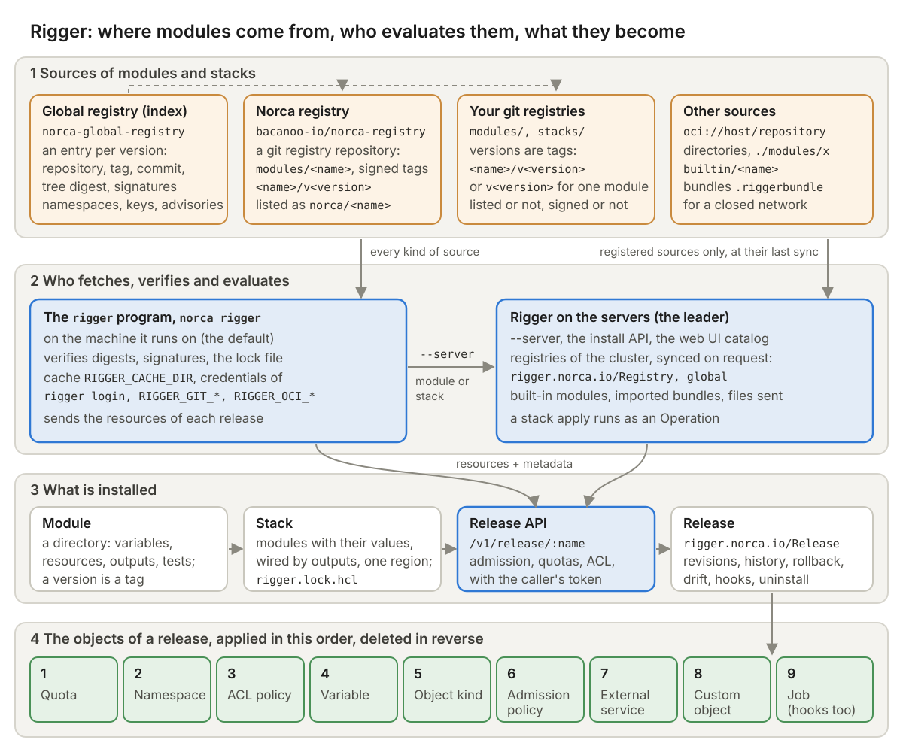

**Rigger** is the package manager of Norca. It installs **modules**, packages written in typed HCL
that hold jobs together with the namespaces, quotas, ACL policies, Variables, object kinds,
admission policies, external services and custom objects that belong to them, and **stacks**,
the modules of a region with their values, wired together through their outputs and pinned in a
lock file. Every install is a **release**: the servers apply its resources in a fixed order,
record a revision, and can upgrade, roll back, test, check for drift and uninstall it.

Rigger is part of Norca. The commands are `norca rigger ...` in the `norca` binary, and the
standalone `rigger` program has the same commands (plus a few generators). The servers of a
cluster run Rigger too: they fetch, verify and evaluate modules for the web UI, the
[install API](/docs/api/rigger-install) and `--server`.



## In five commands

```shell
norca rigger search nats                       # the global registry, without a cluster
norca rigger show norca/nats                   # versions, signers, variables, outputs
norca rigger install norca/nats --version "~> 2.0" --name nats --namespace apps
norca rigger release status nats --namespace apps
norca rigger release rollback nats --namespace apps
```

A module of your own, from its directory:

```shell
norca rigger module validate ./web             # without a cluster: files, examples, jobs decoded
norca rigger module test ./web                 # tests/*.riggertest.hcl
norca rigger install ./web --name shop -f values.vars.hcl
```

Several modules as a stack:

```shell
norca rigger stack sync ./platform             # resolve versions, verify, write rigger.lock.hcl
norca rigger stack plan ./platform -f values/prod.vars.hcl
norca rigger stack apply ./platform -f values/prod.vars.hcl
```

## The parts at a glance

| Part | What it is | Read more |
| --- | --- | --- |
| **Module** | A directory of HCL files named after what they hold: `metadata.hcl`, `variables.hcl`, `<name>.norca.hcl` (a job), `<name>.acl.hcl` (an ACL policy), ..., `outputs.hcl`, `tests/`. | [Writing a module](/docs/rigger/writing-a-module), [module language](/docs/rigger/module-language) |
| **Stack** | A directory with `stack.hcl`: the modules of a region with their values, references between them, a lock file. | [Writing a stack](/docs/rigger/writing-a-stack), [stack language](/docs/rigger/stack-language) |
| **Release** | One install of a module: a `rigger.norca.io/Release` object with revisions, applied by the servers. | [Lifecycle](/docs/rigger/lifecycle), [releases on the servers](/docs/rigger/releases) |
| **Registry** | Where versions come from: the global registry (an index), git registry repositories such as the [Norca registry](/docs/rigger/norca-registry), OCI repositories, directories, built-in modules, bundles. | [Registries and sources](/docs/rigger/registries) |
| **Lock file** | `rigger.lock.hcl` of a stack: the version, commit, tree digest and signers of each module. | [Versions and lock files](/docs/rigger/versions) |
| **Keys and signatures** | Cosign-format keys; a signature of the tree digest of a version in `.rigger-signatures/`; the `trust` of a stack. | [Publishing and signing](/docs/rigger/publishing) |

## Pages in this section


  
  
  
  
  
  
  
  
  
  
  
  
  
  
  
  


## Elsewhere

- **Command reference:** [`norca rigger`](/docs/commands/rigger) and its subcommands.
- **HTTP API:** [Releases](/docs/api/releases), [Rigger Installs](/docs/api/rigger-install),
  [Rigger Stacks](/docs/api/rigger-stacks), [Rigger Registries](/docs/api/rigger-registries).
- **Web UI:** the **Packages** page, with its catalog and install form
  ([Rigger catalog](/docs/features/packages/rigger-catalog)).
- **Deployer:** a deployment plan applies a stack after the cluster is up
  ([Rigger stacks of the deployer](/docs/deployer/rigger)).
- **Feature overview:** [Package management](/docs/features/packages).
