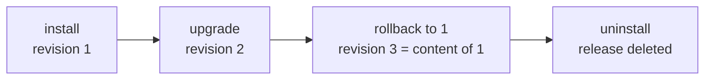

Every install of a module is a **release**, and every change of a release is a new **revision**:



## One release, without a stack

```shell
# Install: revision 1.
norca rigger install ./web --name shop --namespace apps -f values.vars.hcl
norca rigger install norca/nats --version "~> 2.0" --name nats --namespace apps

# Upgrade: the same name with other values or another version, revision 2.
norca rigger install ./web --name shop --namespace apps -f values.vars.hcl --var count=4

# Look.
norca rigger release list --namespace apps
norca rigger release status shop --namespace apps        # the deployed revision and what drifted
norca rigger release history shop --namespace apps       # every kept revision

# Roll back: the content of an earlier revision, applied as a new revision (3).
norca rigger release rollback shop 1 --namespace apps
norca rigger release rollback shop --namespace apps      # the revision before the deployed one

# Uninstall: pre-delete hooks, resources deleted in reverse order, post-delete hooks.
norca rigger release uninstall shop --namespace apps
```

- **`install` is install-or-upgrade.** Of a directory the module is taken as it is on the disk; of a
  source, the newest version that meets `--version` (the global registry: only with its listed digest
  and a signature of its namespace).
- **`install` waits until the release is ready** (the deployments of its jobs healthy, its post-hooks
  done), up to `--timeout`.
- **A rollback applies stored content**: the resources of the old revision as they were rendered,
  without evaluating the module again. Secret items that the rollback sends no value for keep their
  stored value.
- **An uninstall deletes only what is still the release's.** A resource someone else re-created
  under its name, or one another release or a tenant owns now, is left with a warning.

## A stack

```shell
rigger stack sync                       # pin the versions (rigger.lock.hcl)
rigger stack plan  -f values/prod.vars.hcl
rigger stack apply -f values/prod.vars.hcl
rigger stack status
rigger stack apply -f values/prod.vars.hcl --prune     # also uninstall what the stack no longer has
rigger stack destroy                    # uninstall every release of the stack
```

- **The stack owns its releases** (by its namespace and name, recorded in `spec.owner` of each).
  `apply` installs and upgrades them in the order of their references, waiting for each; a release
  whose digest did not change is left alone.
- **`--prune`** uninstalls the releases the stack owns whose `module` block is gone. A block with
  `enabled = false` is not gone: its release stays installed.
- **`destroy`** uninstalls every release of the stack, in the reverse order of an apply.
- **Rollback is per release:** `rigger release rollback <name>` rolls back one release of a stack;
  the next `stack apply` brings it to what the stack says again.

## Taking over a release: `--adopt`

**A release has one owner.** An install or apply that would take a release from another stack, or
from another manager, is refused:

```plaintext
release apps/web belongs to the stack apps/other: it is taken over only when asked to (adopt; the flag --adopt)
```

`--adopt` (`stack apply --adopt`, `install --adopt`, `release rollback --adopt`, **Take over the
release** in the web UI) takes it over. An apply takes over only what its plan showed; a release that
became another's after the plan is refused.

## Tests

The `test` hooks of a release (batch jobs with `hook { on = ["test"] }`) run on request: from the page
of the release in the web UI, or with `POST /v1/release/:name/test`. The result is recorded in the
release (`status.lastTest`) and its event log. See [hooks and tests](/docs/rigger/releases#hooks-and-tests).

## Drift detection

After every apply the servers record a hash of the content of each resource. `rigger release status`,
`rigger stack status` and a check on the leader every 5 minutes compare the live resources with it:
a resource that was changed or deleted outside the release sets the condition `Drifted` and publishes
a `ReleaseDrifted` event. **Drift is never corrected on its own**: upgrade or roll back to apply the
release again. The web UI shows the drift on the page of each release and stack.

## The program or the servers

Rigger evaluates a module either in the `rigger` program (on the machine it runs on) or on the servers.
Both send the same resources through the release API with the caller's token.

| | The program (default) | The servers (`--server`, `RIGGER_SERVER=1`) |
| --- | --- | --- |
| Commands | all | `install`, `stack plan`, `apply`, `status`, `destroy`, `bundle import` |
| Sources | every kind, with the credentials of the machine | registered sources only: registries of the cluster at their last sync, built-in modules, bundles, the files sent |
| A directory | read on the machine | sent as files (`./modules/...` of a stack too) |
| A stack apply | the program applies release after release and must keep running | an operation on the leader; the program follows its log; Ctrl-C cancels before the next release, a second Ctrl-C leaves it running |
| Admission sees | `serverRendered = false` | `serverRendered = true` (unless only a bundle vouches for the content) |
| Same everywhere | the lock file, the values, the releases, the ACL checks of every resource | |

Choose **the servers** when:

- an admission policy of a protected namespace requires releases the servers rendered
  (`release.pack.serverRendered`);
- the web UI, the [install API](/docs/api/rigger-install) or GitOps installs from a registry of the
  cluster;
- the machine that applies can't reach the sources, but the servers can (or a bundle was imported);
- an apply must outlive the terminal that started it.

Choose **the program** when the stack uses sources the servers don't read (`oci://`, directories outside
the stack, unregistered git repositories), or when no registry is registered in the cluster yet.

```shell
norca rigger registry sync global                 # the servers read the global registry at its last sync
norca rigger stack apply ./platform --server -f values/prod.vars.hcl
norca rigger operation follow platform-20261122-140938-a847   # reach a running operation again
norca rigger operation cancel platform-20261122-140938-a847
```

With `--server`, `install` takes `<namespace>/<name>` of the global registry, `<name> --registry <registry>`
of another registry of the cluster, `builtin/<name>`, or a directory (sent as files). A git or `oci://`
address is refused in this mode: register its repository as a registry, or install without `--server`.

## Atomic installs

With `atomic = true` (a module of a stack) a failure of any step of an install or upgrade restores what
the operation changed, and the release stays on its previous revision. In a **production namespace**
(its meta `environment` is `production` or `prod`) operations are atomic unless the release says
otherwise. See [atomic mode](/docs/rigger/releases#atomic-mode-and-production-namespaces).
